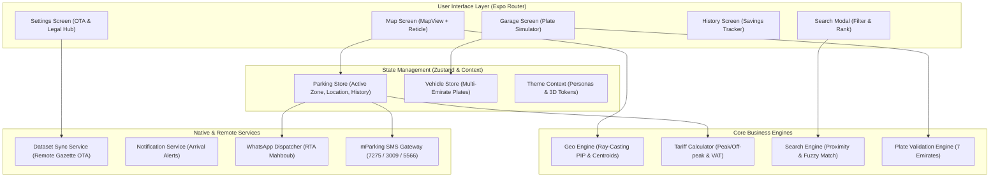
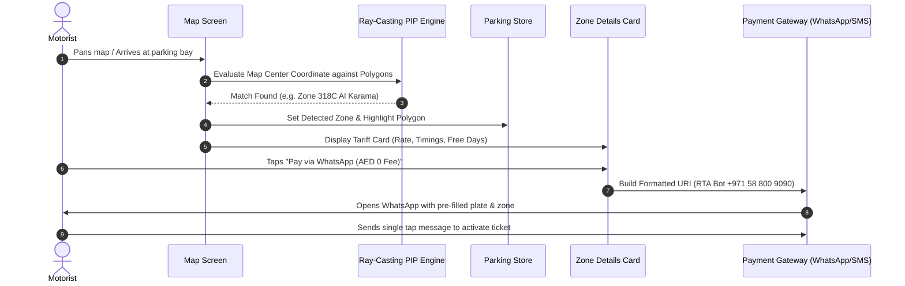
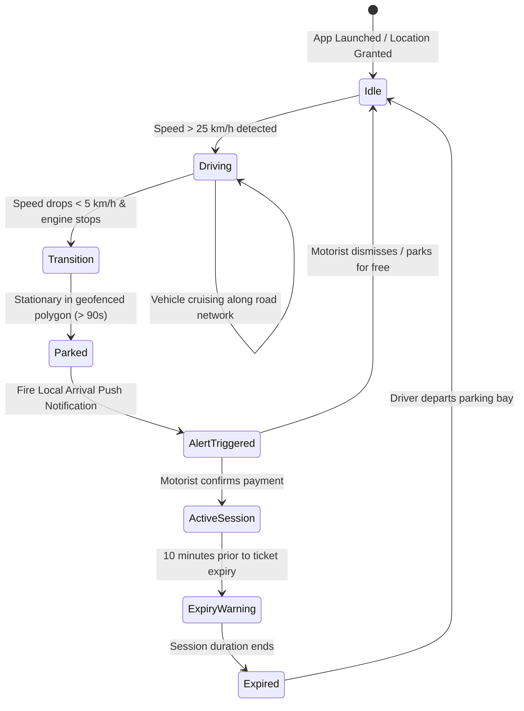

# 🚗 ParkingPilot (UAE Parking Assistant)

[](https://expo.dev)
[](https://reactnative.dev)
[](https://www.typescriptlang.org)
[](https://jestjs.io)
[-059669?style=flat&logo=shield)](https://uaecabinet.ae)

> **ParkingPilot** is an intelligent, privacy-first mobile parking assistant designed specifically for motorists navigating parking regulations across the United Arab Emirates (Dubai, Abu Dhabi, Sharjah, and Northern Emirates).
>
> It combines real-world GIS polygon boundaries, real-time reticle crosshair detection, fee-free WhatsApp payment dispatching, authentic multi-Emirate license plate rendering, and tactile 3D driver persona styling.

---

## 🌟 Key Features

### 1. Interactive Polygon Maps & Reticle Zone Detection
* **Closed Shoreline Polygons:** Accurate municipal GIS polygons for Dubai (Parkin PJSC / RTA), Sharjah (Al Majaz Waterfront 5566, Buheira Corniche), and Abu Dhabi (ITC Mawaqif Corniche).
* **Ray-Casting Point-in-Polygon Engine:** Detects the active parking zone beneath the central crosshair reticle as the user pans the map.
* **Floating Tooltip & Centroid Easing:** Automatically flies the camera to the geometric centroid of zones with smooth easing and displays instant detection tags.
* **Emirate Filters:** One-tap filtering across `ALL`, `DXB (Dubai)`, `SHJ (Sharjah)`, and `AUH (Abu Dhabi)`.

### 2. Full Zone Search Engine with Proximity Distance
* **Instant Keyword Lookup:** Search by Zone Code (`318C`, `626M`, `5566`, `701A`, `S`) or Community / Area Name in English & Arabic (`Al Karama`, `Al Majaz`, `Deira`).
* **Live GPS Distance Ranking:** Sorts matching zones dynamically based on user walking or driving distance (e.g. `120 m`, `2.4 km`).
* **Auto-Focus Modal:** Keyboard slides up immediately upon launch; selecting a zone flies the camera and highlights its polygon.

### 3. 1-Tap Direct Payment Dispatchers (WhatsApp & SMS)
* **Official WhatsApp Mahboub Integration (AED 0 Fee):** Dispatches pre-formatted parking requests to the official RTA Dubai WhatsApp bot (`+971 58 800 9090`) with **zero telecom surcharge**.
* **Direct mParking SMS Dispatcher:** Pre-fills and opens native system messaging with authority formatting:
  * **Dubai (7275):** `<Plate> <Zone> <Duration>`
  * **Abu Dhabi (3009):** `AUH<Category> <Plate> <Type> <Duration>`
  * **Sharjah (5566):** `SHJ <Plate> <Duration>`
  * **Ajman (5155)**
* **Tariff Engine:** Computes peak vs. off-peak pricing, multi-hour multipliers, 24-hour caps, and 5% UAE VAT.

### 4. Multi-Emirate Garage & Authentic Plate Simulator
* **All 7 UAE Emirates Supported:** Dubai, Abu Dhabi, Sharjah, Ajman, Ras Al Khaimah, Umm Al Quwain, and Fujairah.
* **High-Fidelity Official Plates:**
  * **Abu Dhabi (AUH):** Red vertical category band with watchtower emblem and category number.
  * **Dubai (DXB):** Official Arabic/English calligraphy header (*"دبي / DUBAI"*), letter series badge, and embossed digits.
  * **Sharjah (SHJ):** Orange header with the official Sharjah ribbon crest.
  * **Ajman, RAK, UAQ, Fujairah:** Authentic municipal fort, dhow, and tower crests.
* **Authority Pattern Validation:** Enforces strict numeric category bands for Abu Dhabi and Sharjah, letter series for Dubai/Northern Emirates, and 1–5 digit limits.

### 5. Tactile 3D Aesthetics & Driver Personas
* **Driver Persona Selector:**
  * 🚗 **Boy Driver (Light Sky Blue):** Morning sky gradient (`#E0F2FE` &rarr; `#F8FAFC` off-white) with deep navy typography.
  * 🌸 **Girl Driver (Light Blush Pink):** Soft blossom rose gradient (`#FCE7F3` &rarr; `#FDFCFB` off-white) with deep plum typography.
* **Physical 3D Elevation:** Multi-layer drop shadows with top-light bevel highlights.
* **Full Contrast Readability:** High-contrast color tokens tested for direct UAE sunlight in Light and Dark modes.

### 6. Over-The-Air (OTA) Registry Sync
* **Zero App Store Lag:** Checks remote municipal registries for newly gazetted zones (e.g. Dubai Islands, Deira Marina) and applies them live without restarting the app.
* **Rollback Safety:** 1-tap option to restore the bundled seed registry at any time.

### 7. UAE Legal & Statutory Compliance Hub
* **Streamlined Accordions:** Five concise summary cards with "What it means for you" bullet points and direct links to official portals:
  * *UAE Cybercrimes Law No. 34/2021* (Independent Utility Status)
  * *UAE PDPL Law No. 45/2021* (Zero Remote Telemetry & On-Device Processing)
  * *Federal Decree-Law No. 8/2017* (5% VAT & SMS convenience fee breakdown)
  * *Dubai Executive Council Res. No. 5/2016* (10-minute grace buffers & Sunday free parking)
  * *UAE Federal Law No. 29/2006* (Sanad People of Determination exemptions)
* **Verbatim Gazette Modal:** Slide-up sheet to inspect exact statutory law articles.

---

## 🏗️ Architecture & System Design

### 1. High-Level System Architecture



---

### 2. Zone Detection & 1-Tap Payment Flow



---

### 3. Background Motion & Geofencing Lifecycle



---

## 📂 Project Structure

```
parking-ticket-buddy/
├── __tests__/                      # Comprehensive Jest Test Suites (42 Tests)
│   ├── constants/                  # Plate pattern & Emirate validation tests
│   ├── services/                   # Zone lookup and OTA sync tests
│   └── utils/                      # Geo ray-casting, tariffs, and search tests
├── src/
│   ├── app/                        # Expo Router Pages
│   │   ├── (tabs)/
│   │   │   ├── _layout.tsx         # Tab layout with dynamic iOS home-bar clearance
│   │   │   ├── index.tsx           # Map Screen with reticle & floating action buttons
│   │   │   ├── vehicles.tsx        # Garage screen with 7-Emirate plate graphics
│   │   │   ├── history.tsx         # Parking ticket history & savings calculator
│   │   │   └── settings.tsx        # Persona switch, OTA sync, and UAE Legal Hub
│   │   └── _layout.tsx             # Root layout with Theme Provider
│   ├── components/                 # Reusable UI Components
│   │   ├── common/GradientCard3D   # Tactile 3D card with linear gradient
│   │   ├── settings/               # Elevated settings groups and rows
│   │   ├── LicensePlateView.tsx    # Official UAE metallic plate graphics
│   │   ├── SearchZoneModal.tsx     # Instant zone search modal
│   │   └── ZoneDetailCard.tsx      # Bottom tariff and payment drawer
│   ├── constants/                  # Domain Constants
│   │   ├── platePatterns.ts        # Official plate formats for all 7 Emirates
│   │   └── uaeParking.ts           # UAE municipal gateways & operating hours
│   ├── database/                   # GIS Database
│   │   ├── dubaiParkingZones.json  # Precise parking polygons (Dubai, SHJ, AUH)
│   │   └── seedData.ts             # Initial bundled database release
│   ├── services/                   # Service Layer
│   │   ├── datasetSyncService.ts   # Over-the-air database updates
│   │   ├── notificationService.ts  # Push notification triggers
│   │   └── zoneLookupService.ts    # Ray-casting polygon queries
│   ├── store/                      # Zustand State Management
│   │   ├── parkingStore.ts         # Active sessions & detected zones
│   │   └── vehicleStore.ts         # Persisted vehicle garage
│   ├── theme/                      # Design System & Styling
│   │   ├── ThemeContext.tsx        # Persona & theme switching provider
│   │   └── tokens.ts               # Light, dark, and pastel color tokens
│   ├── types/                      # TypeScript Interfaces
│   └── utils/                      # Computational Utilities
│       ├── geoUtils.ts             # Ray-casting point-in-polygon & centroids
│       ├── searchUtils.ts          # Zone ranking and distance calculation
│       ├── smsFormatter.ts         # Multi-Emirate SMS body generators
│       └── tariffCalculator.ts     # Tariff & 5% VAT calculations
├── app.json                        # Expo app configuration
├── package.json                    # Dependencies & scripts
└── tsconfig.json                   # Strict TypeScript compiler options
```

---

## 🚀 Getting Started

### Prerequisites
* **Node.js**: v18.0.0 or higher
* **Expo CLI**: bundled with Expo SDK 58
* **Device**: iOS Simulator, Android Emulator, or physical device with **Expo Go**

### Installation
```bash
# Clone the repository
git clone https://github.com/vineetsansare/ParkingPilot.git
cd ParkingPilot

# Install dependencies (SDK-compatible versions)
npx expo install
```

### Running the App
```bash
# Start Metro bundler with cache reset
npx expo start -c

# Run on iOS Simulator
npx expo start --ios

# Run on Android Emulator
npx expo start --android
```

### Quality & Verification
```bash
# Run strict TypeScript typecheck
npx tsc --noEmit

# Run Jest unit test suite (42 tests across 8 suites)
npm test

# Diagnose Expo configuration
npx expo-doctor
```

---

## ⚖️ UAE Statutory Disclosures & Compliance

* **Independent Software Utility:** In accordance with UAE Federal Decree-Law No. (34) of 2021 Concerning the Fight Against Rumours and Cybercrimes (Articles 11 & 18), ParkingPilot is an independent software tool. It is **not** affiliated with, authorized, or endorsed by Parkin PJSC, RTA Dubai, ITC Abu Dhabi (Mawaqif), or Sharjah Municipality.
* **Direct Payments Only:** The app **never** collects, holds, or intermediates funds. Payments are dispatched directly via your native messaging apps to official government channels.
* **On-Device Privacy Guarantee:** Under UAE Federal Decree-Law No. (45) of 2021 on Personal Data Protection (PDPL), all vehicle plate registrations, parking session history, and GPS coordinates are stored and processed **100% on-device**. There is zero cloud telemetry or user tracking.
* **Statutory Taxes & Telecom Surcharges:** Displayed parking estimates include statutory 5% UAE VAT levied under Federal Decree-Law No. (8) of 2017. mParking SMS incurs an operator convenience fee of AED 0.30 billed by telecom carriers (e& / du); WhatsApp payments via official RTA Mahboub incur **AED 0** convenience surcharge.

---

## 📄 License
This project is licensed under the MIT License — see the [LICENSE](LICENSE) file for details.
